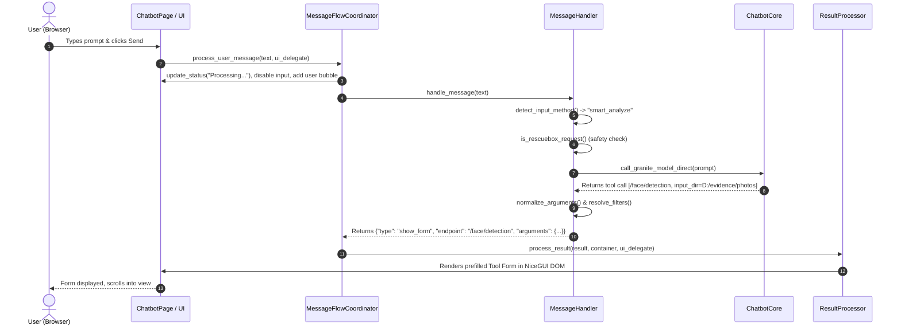

# Chatbot Architecture: Domain vs. Presentation

This document outlines the architectural separation of concerns between `frontend/chatbot/` and `frontend/pages/chatbot/`.

---

## 1. High-Level Architectural Division

RescueBox separates the chatbot into two distinct layers:
1. **Domain & AI Layer (`frontend/chatbot/`)**: Headless business logic, LLM communication, tool schemas, and backend API interactions. Completely independent of the UI framework.
2. **Presentation & Page Layer (`frontend/pages/chatbot/`)**: NiceGUI web application code, route handling, DOM generation, event callbacks, reactive UI state, and user interactions.

```
                      User in Browser
                            │
                            ▼
┌────────────────────────────────────────────────────────┐
│  frontend/pages/chatbot/                               │  <-- PRESENTATION LAYER
│  - NiceGUI DOM elements, buttons, input fields         │      (Tied to NiceGUI & Browser)
│  - Chat history sidebar drawer, modal pickers          │
│  - Reactive UI state (status label, scroll position)   │
└───────────────────────────┬────────────────────────────┘
                            │ Delegates user prompt / receives tool schema
                            ▼
┌────────────────────────────────────────────────────────┐
│  frontend/chatbot/                                     │  <-- DOMAIN / AI LAYER
│  - IBM Granite LLM integration (Ollama API)            │      (Headless, UI-Agnostic)
│  - Forensic tool schemas & Pydantic models             │
│  - Slash command routing & input safety filters        │
│  - HTTP API communication with RescueBox backend       │
└────────────────────────────────────────────────────────┘
```

---

## 2. Side-by-Side Comparison

| Feature | `frontend/chatbot/` | `frontend/pages/chatbot/` |
| :--- | :--- | :--- |
| **Architectural Layer** | **Domain / AI / Backend Service** | **Presentation / Web Page** |
| **Primary Responsibility** | Understands *what* the user wants (LLM, tool schemas, backend API calls). | Displays the chat interface and handles user clicks/typing in the browser. |
| **NiceGUI Dependency** | **None** (UI-agnostic pure Python). | **Heavy** (relies on NiceGUI `ui.row`, `ui.label`, `ui.button`, `@ui.page`). |
| **Execution Context** | Headless business logic callable by tests, CLI, or any UI. | Client session bound to an active web browser connection. |
| **Key Components** | • `core.py`: `ChatbotCore` API client<br>• `granite.py`: Direct LLM caller<br>• `message_handler.py`: Prompt parsing & AI routing<br>• `tool_config.py`: Tool schemas & Pydantic models<br>• `multi_tool/`: Multi-step workflow sequencing<br>• `pipeline_context.py`: Output-to-input path chaining | • `routes.py`: `@ui.page("/chatbot")`<br>• `chat_page.py`: Main `ChatbotPage` coordinator<br>• `ui_builder.py`: Message list, inputs, headers<br>• `state.py`: `ChatbotStateManager`<br>• `message_flow_coordinator.py`: UI workflow orchestration<br>• `result_processor.py`: DOM rendering of responses<br>• `history_ui.py`: Conversation drawer |

---

## 3. Directory Breakdown

### `frontend/chatbot/` (The Brain)
- **`core.py` (`ChatbotCore`)**: Central API client that interfaces with backend tool endpoints (`/api/v1/...`) and Ollama/Granite LLMs.
- **`granite.py`**: Prompt engineering and direct REST invocation for IBM Granite models.
- **`message_handler.py` (`MessageHandler`)**: Routes user messages between slash commands (e.g. `/help`, `/transcribe`) and natural language smart analysis. Applies safety/forensic prompt filtering.
- **`tool_config.py` & `config.py` (`ToolRegistry`)**: Defines schemas for all forensic tools (`AudioTranscribe`, `FaceFindBulk`, `FileSystemScan`, etc.) and system prompts.
- **`multi_tool/` & `multi_tool_handler.py`**: Handles multi-tool dependency graphs and execution order.
- **`pipeline_context.py`**: Helper functions for injecting and retrieving chained output directory paths between consecutive tools.
- **`forms.py` & `schema_utils.py`**: Converts tool schemas into initial argument structures.
- **`api_helpers.py`**: HTTP client wrappers for querying backend status and task endpoints.

### `frontend/pages/chatbot/` (The Face)
- **`routes.py`**: Registers the NiceGUI page endpoint `/chatbot` and handles URL query parameters (`?rerun=`, `?load_conversation=`).
- **`chat_page.py` (`ChatbotPage`)**: Top-level page instance connecting UI builders, event handlers, and tool reruns.
- **`ui_builder.py` (`ChatUIBuilder`)**: Constructs NiceGUI UI widgets (scroll area, header, footer, textarea, action buttons).
- **`message_flow_coordinator.py` (`MessageFlowCoordinator`)**: Orchestrates outgoing user messages, status spinners, and incoming result dispatching.
- **`result_processor.py` (`ResultProcessor`)**: Translates handler results into UI components (chat bubbles, error notices, or interactive tool forms).
- **`state.py` (`ChatbotStateManager`)**: Reactive state for active conversation ID, input field enabled/disabled status, and active jobs.
- **`history_ui.py`**: Renders the conversation history sidebar drawer and conversation selection/deletion controls.
- **`pickers.py`**: Modal dialogs for interactive "Tools" and "Workflows" selection.
- **`form_submit_handler.py` & `handlers/`**: Validates form inputs, opens case note dialogs, and submits jobs to the backend.
- **`database_service.py`**: Bridges UI interactions to SQLite persistence (`chat_history_db` and `job_db`).

---

## 4. End-to-End Collaboration Flow

Here is the trace of a single user chat turn (e.g., user asks: *"Find all faces in directory D:/evidence/photos"*):


