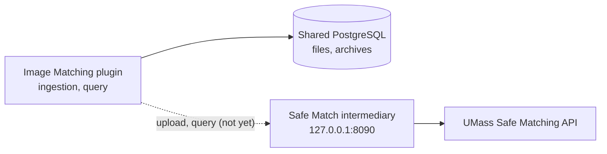

# Image Matching Plugin

The RescueBox matching plugin from the Safe Semantic Matching design. It has two parts:

- **Ingestion (implemented):** hashes a folder of images into the shared PostgreSQL database. Each ingestion creates an **archive** named by a unique investigation label. Each distinct image (by SHA-256) is stored once and reused by every archive that contains it, so re-ingesting known images only computes the hashes they are missing.
- **Query and upload (not yet implemented):** query will search local archives by hash and compare essays with other agencies' through the UMass Safe Matching service; ingestion will upload essays to it.

The plugin never talks to UMass directly. It will call the separate Safe Match intermediary (`src/safe-match-intermediary`, a local service that holds the agency's credentials) through the client in `rb.lib.safe_match`, and the intermediary calls the UMass Safe Matching API.



The in-app description is in [`app-info.md`](image_matching/app-info.md).

## Layout

| Path | Responsibility |
|---|---|
| `image_matching/main.py` | Registers the plugin and its tasks |
| `image_matching/archive_store.py` | Reads and writes the shared `files`, `archives` and `archive_files` tables |
| `image_matching/image_ingestion/` | Ingest, delete and rename archive tasks (implemented) |
| `image_matching/hashing/` | SHA-256 and MD5 (`hashers.py`, which calls `image-similarity` for PDQ, semantic and private hashes), essay generation (`essay.py`) and PII redaction (`privacy.py`) |
| `image_matching/query/` | Not yet implemented; will search archives by hash and query essays through the intermediary |

## Tasks

| Task | Route | Purpose |
|---|---|---|
| Ingest Images | `/image_matching/ingest_images` | Hash a folder into a new archive |
| Delete Archive | `/image_matching/delete_archive` | Delete an archive; optionally keep its hashes for faster re-ingestion |
| Rename Archive | `/image_matching/rename_archive` | Change an archive's label |

Ingest Images takes a folder of images in common formats (JPEG, PNG, BMP, WebP), a label (defaults to the folder name), a description, and four hash options that default to Yes. SHA-256 is always computed.

| Hash | Computed by |
|---|---|
| SHA-256, MD5 | `hashing/hashers.py` |
| PDQ, semantic, private | `image-similarity` (SigLIP2 and CLIPSeg ONNX models); Semantic also creates the private hash |
| Essay | `hashing/essay.py` (`qwen3-vl:4b-instruct` through Ollama), redacted by `hashing/privacy.py` (Presidio) |

The **essay** is one plain paragraph describing people, then key objects, then the scene, kept to whole sentences within 60 words and 350 characters. Essays will be sent to the UMass Safe Matching service through the Safe Match intermediary; this is not yet done, and essays stay in the local database only. They are not written to the backend log; use the essay smoke test below to read them.

## Requirements

- PostgreSQL with pgvector, started by `./run_backend_server`.
- MD5 and PDQ: nothing else; they run on CPU.
- Semantic: the `image-similarity` SigLIP2 and CLIPSeg ONNX models; download them with the commands in [image-similarity installation](../image-similarity/README.md#5-installation).
- Essay: Ollama. `qwen3-vl:4b-instruct` (about 3 GB, several GB of RAM; a GPU helps) is pulled on first use, and Presidio's spaCy model `en_core_web_lg` (about 600 MB) is installed with this plugin.

## Demo images

`src-tauri/demo/image-matching/` holds three image series (3, 3 and 11 images) from the UMass Rescue [image-series-dataset](https://github.com/UMass-Rescue/image-series-dataset), which groups [Wikimedia Commons](https://commons.wikimedia.org) photographs of political figures into series by event. Each image remains under the license on its Commons file page.

## Try it

Start the backend from the repository root and leave it running:

```bash
./run_backend_server
```

### Smoke test

In a second terminal:

```bash
./src/image-matching/smoke_test.sh
```

It ingests `series_0013_Alexandria_Ocasio-Cortez_2019` with MD5 and PDQ only, then checks the duplicate-label error, rename, delete, and the not-found error. Each request is printed as a `curl` command. A passing run ends with `PASS: ingest, duplicate label, rename, delete` and exits 0; otherwise it prints `FAIL` and exits nonzero. It deletes its own archive. Set `RESCUEBOX_API` to use a backend other than `http://127.0.0.1:8000`.

To also check essays (needs Ollama and Docker; the first run downloads the essay model):

```bash
ESSAY=1 ./src/image-matching/smoke_test.sh
```

After the steps above, it ingests the same folder with Essay only, prints the three redacted essays straight from the `rb-postgres` database (the `psql` command is printed too), checks there are three, deletes that archive, and ends with `PASS: essays`.

### UI

In a second terminal run `./run_ui_server`, open http://localhost:8080/chatbot, click **Menu**, then **11. Image Matching -> Open**.

| Try | Expected result |
|---|---|
| Ingest `series_0013_Alexandria_Ocasio-Cortez_2019`, label blank, Semantic and Essay No | `Archive 'series_0013_Alexandria_Ocasio-Cortez_2019': 3 files.` |
| The same ingest again | "Label already in use" |
| Ingest `series_0014_Alexandria_Ocasio-Cortez_2019` with Essay Yes | `3 files.`; essays are stored in the `files.essay` column |
| The same folder again with a new label | Finishes quickly; existing hashes are reused |
| Rename `series_0013_Alexandria_Ocasio-Cortez_2019` to `demo-case` | "Archive renamed" |
| Delete `demo-case` with Retain hashes No | "Archive deleted" (3 files) |

Delete any remaining demo archives when done.

## Unit tests

No Postgres, Ollama or ONNX models needed (archive tests use in-memory SQLite):

```bash
poetry run pytest src/image-matching/tests
```
